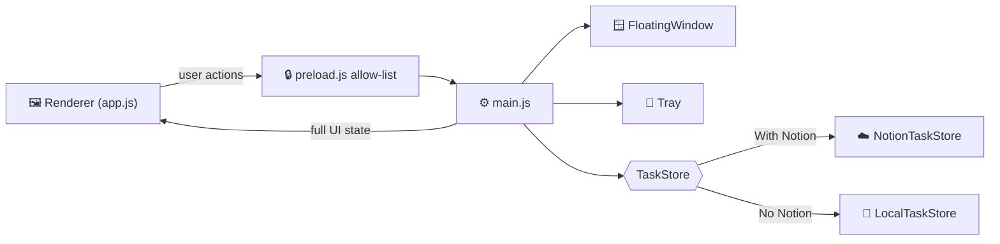

<p align="center">
  
</p>

<h1 align="center">🛠️ Salchi Desktop · source code</h1>

<p align="center">
  The Electron app behind <a href="../Windows/">Salchi for Windows</a> and <a href="../Linux/">Salchi for Linux</a>.<br>
  One code base, two editions (With Notion / No Notion), three package types.
</p>

<p align="center">
  
  
  
</p>

---

## 🚀 Development

```sh
npm install
npm start             # Notion edition
npm run start:local   # local edition
npm test              # end-to-end tests (uses xvfb-run on headless Linux)
```

## 📦 Packaging

```sh
npm run dist:notion   # dist/notion/  Salchi-Setup-con-Notion.exe, .AppImage, .deb
npm run dist:local    # dist/local/   Salchi-Setup-sin-Notion.exe, .AppImage, .deb
```

Building the Windows installer on Linux or macOS requires Wine.

> [!NOTE]
> The installers are not code-signed, so Windows SmartScreen shows a warning the first time
> ("More info" → "Run anyway").

## 🧩 How it is organised

```
src/
├── main/                      Main process
│   ├── main.js                Entry point: wires store, window, tray and IPC
│   ├── edition.js             Notion vs. local edition
│   ├── floating-window.js     The always-on-top window: sizes, hover, dragging, menus
│   ├── tray.js                Tray icon and menu
│   ├── config.js              Settings file; the Notion token is encrypted with safeStorage
│   ├── autostart.js           Open at login (Windows API / freedesktop autostart on Linux)
│   ├── due-dates.js           Due-date validation, sorting and Google Calendar links
│   ├── i18n.js                Loads the translations in ../locales and picks the language
│   ├── notion-client.js       Minimal Notion REST client
│   └── stores/                TaskStore base class + Notion and local implementations
├── preload.js                 The only API the renderer can use (context isolation)
├── renderer/                  index.html, styles.css, app.js
└── assets/                    Window and tray icons
build/                         electron-builder configs, icons, Linux packaging hooks, installer language menu
test/                          End-to-end tests driving the real UI
```



The main process owns all data and sends the complete UI state to the renderer after every
change; the renderer only draws it and reports user actions. This keeps the renderer simple
and makes the app easy to test from the main process.

<details>
<summary><b>🖥️ Platform notes</b></summary>

<br>


- **Hover on Windows** is detected by polling the cursor position, because DOM mouse events
  can be lost while the window is being resized under the cursor.
- **Linux** has no global cursor position under Wayland, so the renderer reports hover
  instead. The app runs through XWayland (`--ozone-platform=x11`), since Wayland does not let
  apps position their own windows.
- **Ubuntu 24.04+** blocks the user namespaces Chromium's sandbox relies on. The `.deb`
  installs an AppArmor profile (as Chrome and VS Code do); the AppImage starts with
  `--no-sandbox`. See `build/hooks/after-pack.js` and `build/linux/postinst.sh`.

</details>

<details>
<summary><b>🔁 Data compatibility</b></summary>

<br>


- Version 1.0 of the local edition stored tasks in `tareas.json` with Spanish keys. It is
  imported automatically into `tasks.json` on first launch and the old file is kept as a backup.
- The `checkbox` setting key from 1.0 is migrated to `doneProperty`.

</details>

<p align="center"><sub><a href="../">← Salchi home</a></sub></p>
