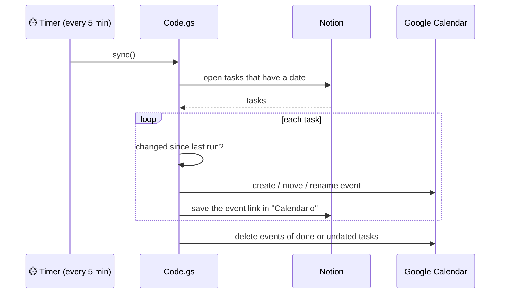

  

<h1 align="center">🗓️ Salchi → Google Calendar</h1>

  Every task with a due date shows up in your Google Calendar, all by itself. 
  For the <b>With Notion</b> edition on any platform · runs on Google's servers · free

  
  
  

---

## ✨ What it does

[`Code.gs`](Code.gs) keeps a calendar called **Salchi 🐕** (yellow) in step with your Notion task list:

| In Salchi / Notion | In Google Calendar |
| --- | --- |
| 📅 A task gets a date | An all-day event appears |
| ⏰ A task gets a date **and a time** | A 30-minute event appears, with a reminder 15 minutes before |
| ✏️ You change the date or the text | The event moves or is renamed |
| ✅ You tick it off, remove its date or delete it | The event disappears |
| ↩️ You un-tick it | The event comes back |

Each event links back to its task in Notion, and the task gets a link to the event, so Salchi shows a 🔗 next to the
date: click it and the event opens.

> [!TIP]
> It lives in your own Google account and runs on Google's servers, so it keeps working while your computers are
> off. No Google Cloud project, no API keys.

## 🚀 Set it up (once)

**1. Get your Notion token.** It's the same one you pasted into Salchi (it starts with `ntn_`).
If you don't have it at hand: [notion.so/profile/integrations](https://www.notion.so/profile/integrations) → your
integration → **Internal integration secret → Show → Copy**.

**2. Create the script.**

1. Go to [script.google.com](https://script.google.com) (with the Google account whose calendar you want) and click
   **New project**.
2. Rename it from *Untitled project* to **Salchi Calendar**.
3. Delete everything in the editor and paste the whole content of [`Code.gs`](Code.gs).
4. In `const NOTION_TOKEN = 'PASTE_YOUR_TOKEN_HERE';` replace `PASTE_YOUR_TOKEN_HERE` with your token (keep the quotes).
5. If your list is not the one already filled in, also replace `NOTION_DATABASE` with the link of your *Salchi* page
   in Notion (**••• → Copy link**).
6. Save with <kbd>⌘</kbd> <kbd>S</kbd> / <kbd>Ctrl</kbd> <kbd>S</kbd>.

**3. Start it.**

1. In the function menu at the top, choose **install** and click **▶ Run**.
2. Google asks for permission, which is normal for your own scripts:
   **Review permissions** → your account → *"Google hasn't verified this app"* → **Advanced** →
   **Go to Salchi Calendar (unsafe)** → tick every box → **Continue**.
3. The log at the bottom says **✅ Done**. Open Google Calendar: the *Salchi 🐕* calendar is there.

<b>🧰 The three functions</b>

 

| Function | When to run it |
| --- | --- |
| `install` | Once, to create the calendar and the 5-minute timer. Safe to run again, e.g. after pasting a new version. |
| `sync` | Runs by itself every 5 minutes. Run it by hand if you don't want to wait. |
| `uninstall` | Stops the automatic sync. The calendar stays; delete it from Google Calendar if you want. |

<b>🩺 Troubleshooting</b>

 

| Message | Fix |
| --- | --- |
| *Falta tu token de Notion…* (missing token) | Paste the token in `NOTION_TOKEN` and save. |
| *Notion dice: Could not find database…* | Share the list with your integration in Notion: **••• → Connections**. |
| *No encuentro la lista de Salchi en ese enlace* (list not found) | `NOTION_DATABASE` must be the link of the list, or of the page Salchi created it in. |
| *Notion dice: Unexpected error* | A hiccup on Notion's side. The script retries by itself and falls back to a simpler query; run `sync` again later. |

<b>⚙️ How it works</b>

 

- For each task, the script remembers the event it created and a fingerprint of the task (Script Properties), so
  unchanged tasks cost nothing.
- If Notion can't be reached, the script stops **before** the clean-up step, so it never deletes events by mistake.
- Temporary Notion errors (5xx, rate limits) are retried with a short back-off.
- Properties written by the first version of the script are migrated by `install`, so its events are reused rather
  than duplicated.

<a href="../">← Salchi home</a>

