<p align="center">
  
</p>

<h1 align="center">🐧 Salchi for Linux</h1>

<p align="center">
  A <code>.deb</code> for Ubuntu, Debian and Mint, and an AppImage for every other distribution.<br>
  <a href="With%20Notion/"><b>Install · With Notion</b></a> &nbsp;·&nbsp; <a href="No%20Notion/"><b>Install · No Notion</b></a>
</p>

<p align="center">
  
  
  
</p>

---

## 🐕 What's special on Linux

| | Feature | Details |
| :---: | --- | --- |
| 📦 | **Two package types** | `.deb` installs like any app and shows up in your menu. The AppImage is a single file that runs almost anywhere. |
| 🖥️ | **X11 and Wayland** | Works on both. On Wayland it runs through XWayland, because Wayland does not let apps place their own windows. |
| 🛡️ | **Ubuntu 24.04 ready** | The `.deb` installs an AppArmor profile so Salchi's sandbox works with Ubuntu's newer security rules, as Chrome and VS Code do. |
| 🔔 | **Tray icon** | The dog appears in the top bar or system tray: show/hide, settings, quit. |
| 🚀 | **Starts at login** | Uses the standard freedesktop autostart entry, which every desktop environment understands. |
| 🔐 | **Encrypted token** | When a keyring is available (GNOME Keyring, KWallet), your Notion token is encrypted with it. |
| 🗑️ | **Clean removal** | `sudo apt remove salchi` also removes the AppArmor profile. For the AppImage, just delete the file. |

## 🐾 Pick your edition

<table>
<tr>
<td width="50%" valign="top" align="center">
<a href="With%20Notion/"></a>
<h3><a href="With%20Notion/">With Notion →</a></h3>
Same list on all your devices, automatic Google Calendar sync.
</td>
<td width="50%" valign="top" align="center">
<a href="No%20Notion/"></a>
<h3><a href="No%20Notion/">No Notion →</a></h3>
Tasks stay on this computer. Nothing to set up.
</td>
</tr>
</table>

## 🤔 `.deb` or AppImage?

| | `.deb` | AppImage |
| --- | --- | --- |
| **Works on** | Ubuntu, Debian, Linux Mint, Pop!_OS… | Almost any x86_64 distribution |
| **Install** | `sudo apt install ./file.deb` | `chmod +x file.AppImage`, then run it |
| **Appears in the app menu** | ✅ | ➖ (you can add it yourself) |
| **Updates** | Install the new `.deb` on top | Replace the file |

> [!WARNING]
> **GNOME without Ubuntu's tweaks** (e.g. Fedora) hides tray icons by default. Install the
> *AppIndicator and KStatusNotifierItem Support* extension to see Salchi's icon.

---

<details>
<summary><b>🗂️ Where things are stored</b></summary>

<br>

| What | Where |
| --- | --- |
| Program (`.deb`) | `/opt/Salchi`, launcher in `/usr/bin/salchi` |
| Settings (token, position, pin) | `~/.config/Salchi/config.json` |
| Tasks (No Notion edition) | `~/.config/Salchi/tasks.json` |
| Start at login | `~/.config/autostart/salchi.desktop` |

</details>

<details>
<summary><b>🔨 Building from source</b></summary>

<br>

The Linux app is built from the shared desktop code in [`Desktop`](../Desktop/):

```sh
cd Desktop
npm install
npm run dist:notion   # Salchi-con-Notion.AppImage + salchi-con-Notion_amd64.deb
npm run dist:local    # Salchi-sin-Notion.AppImage + salchi-sin-Notion_amd64.deb
```

</details>

<p align="center"><sub><a href="../">← Back to Salchi</a></sub></p>
