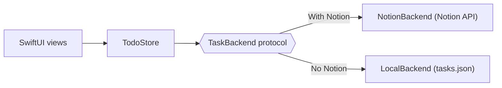

<p align="center">
  
</p>

<h1 align="center">🍎 Salchi for Mac</h1>

<p align="center">
  A native macOS app, written in Swift. Light, quick and at home next to your other Mac apps.<br>
  <a href="With%20Notion/"><b>Install · With Notion</b></a> &nbsp;·&nbsp; <a href="No%20Notion/"><b>Install · No Notion</b></a>
</p>

<p align="center">
  
  
  
</p>

---

## 🐕 What's special on the Mac

| | Feature | Details |
| :---: | --- | --- |
| 🧭 | **Lives in your menu bar** | A `🐕 3` item shows how many tasks are left, with a small menu: show/hide, reload, settings, quit. No Dock icon. |
| 🪄 | **Never steals your focus** | Salchi floats in a special panel: you can tick tasks or type while your current app keeps its focus and menu bar. |
| 🖥️ | **On every Space** | It follows you across desktops (Spaces) and stays visible over full-screen apps. |
| 🧲 | **Snaps to the edges** | Drag the dog anywhere, right up to the screen edges. The list opens towards the centre and stays clear of the menu bar and the Dock. |
| 🌗 | **Light & dark** | The list follows your system appearance. |
| 🔐 | **Keychain** | Your Notion token is stored in the macOS Keychain, not in a file. |
| 🚀 | **Open at login** | One switch in ⚙️ settings, using macOS's own login-items system. |
| 📅 | **Native date picker** | Choose a day on a mini calendar, and a time if you want one. |

## 🐾 Pick your edition

<table>
<tr>
<td width="50%" valign="top" align="center">
<a href="With%20Notion/"></a>
<h3><a href="With%20Notion/">With Notion →</a></h3>
Same list on all your devices, automatic Google Calendar sync.
</td>
<td width="50%" valign="top" align="center">
<a href="No%20Notion/"></a>
<h3><a href="No%20Notion/">No Notion →</a></h3>
Tasks stay on this Mac. Nothing to set up.
</td>
</tr>
</table>

> [!TIP]
> Both editions can be installed side by side: they are separate apps (*Salchi* and *Salchi sin Notion*) with
> separate settings.

---

<details>
<summary><b>🔨 Building from source</b></summary>

<br>

You only need Apple's command-line developer tools:

```sh
xcode-select --install   # once
./build_app.sh           # With Notion  → Salchi.app
./build_app.sh --local   # No Notion    → Salchi sin Notion.app
```

The script:

1. compiles the Swift package in release mode (and cleans the build cache if the folder was moved),
2. wraps the binary into an `.app` bundle with its icon and `Info.plist`,
3. signs it ad hoc, so it runs on this Mac,
4. saves a shareable `.zip` in `With Notion/` or `No Notion/`,
5. replaces and relaunches the copy in `/Applications`, if there is one.

> [!IMPORTANT]
> Ad-hoc signed apps are blocked by Gatekeeper on other Macs. Whoever receives the `.zip` opens the app once from
> **System Settings → Privacy & Security → Open Anyway**.

</details>

<details>
<summary><b>🧩 How the code is organised</b></summary>

<br>

```
Sources/Salchi/
├── Salchi.swift            Entry point
├── App/
│   ├── AppDelegate.swift   Floating panel, menu-bar item, hover / resize / position logic
│   └── Edition.swift       Notion or local edition, read from Info.plist
├── Models/                 TodoItem, DueDate (+ formatting), Google Calendar links
├── Storage/                TaskBackend protocol, Notion and local backends, Keychain, settings
├── State/                  TodoStore (list + optimistic updates), UIState
├── Window/                 FloatingPanel and the window-dragging helper
└── Views/                  The dog, the card, the rows, the date picker, settings
```



- Both editions come from the same sources: `build_app.sh` writes `SalchiEdition` (`notion` or `local`) into
  `Info.plist`, and `Edition.current` reads it at launch.
- `TodoStore` only knows the `TaskBackend` protocol, so the interface is identical in both editions.
- The cursor is polled rather than tracked with `NSTrackingArea`, which can miss the "mouse left" event while the
  window is being resized under the cursor.

</details>

<details>
<summary><b>🗂️ Where things are stored</b></summary>

<br>

| What | Where |
| --- | --- |
| Notion token | Keychain, item `com.claudia.salchi.notion` |
| Notion list, position, pin | `UserDefaults` of the app |
| Tasks (No Notion edition) | `~/Library/Application Support/Salchi/tasks.json` |

</details>

<p align="center"><sub><a href="../">← Back to Salchi</a></sub></p>
