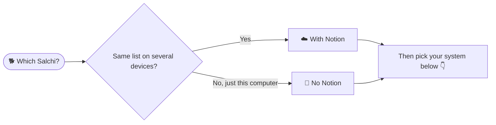
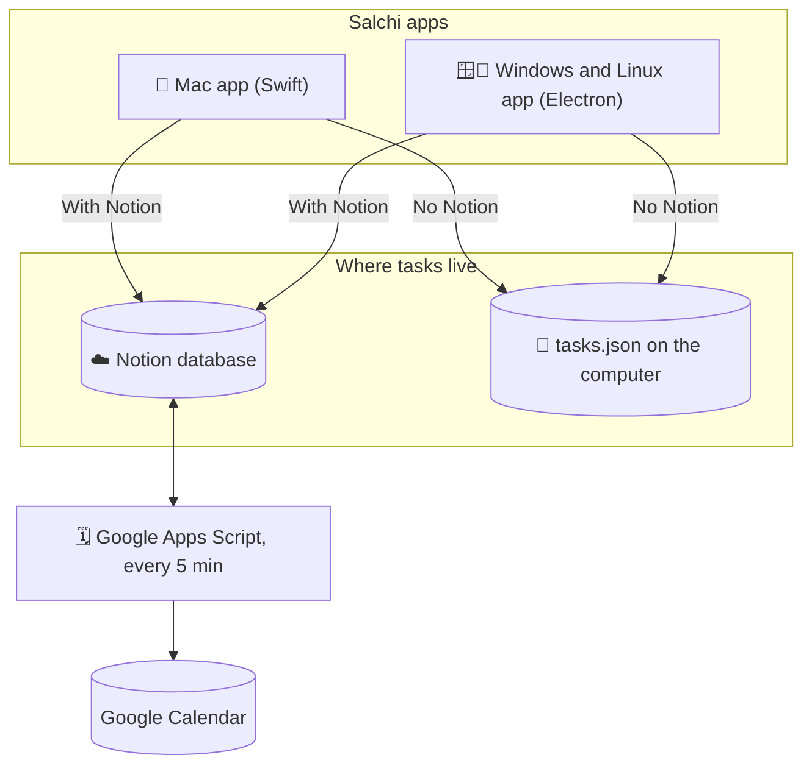

<p align="center">
  
</p>

<p align="center">
  <b>Checking your to-do list shouldn't be another to-do.</b><br>
  Salchi is a tiny dachshund that sits on top of everything on your screen, typing away at its laptop.<br>
  The sticker on the laptop tells you how many tasks are left. Hover over it and the whole list opens.
</p>

<p align="center">
  <a href="Mac/"></a>
  <a href="Windows/"></a>
  <a href="Linux/"></a>
  
</p>

<p align="center">
  <a href="#-what-it-does">What it does</a> ·
  <a href="#-two-editions">Two editions</a> ·
  <a href="#-pick-your-salchi">Pick yours</a> ·
  <a href="#-installation">Installation</a> ·
  <a href="#-how-its-built">How it's built</a>
</p>

---

## ✨ What it does

| Feature | What it means |
| --- | --- |
| 🪟 **Always there** | Floats above every app, on every desktop, even over full-screen windows. |
| 👀 **One-glance check** | The sticky note on the dog's laptop is your counter. Hover to see the list, move away and it folds back. |
| 🧲 **Stays out of the way** | Drag it anywhere, even flush against the edge of the screen. Pin 📌 the list when you want it open. |
| 📅 **Due dates** | Give any task a day, and a time if you like. Overdue tasks turn red, today's turn orange, and the list sorts itself. |
| 🗓️ **Google Calendar** | Dated tasks can show up in your Google Calendar, and disappear when you tick them off. |
| 🤖 **AI can reach it too** | In the Notion edition, an assistant connected to your Notion (like Claude) can add tasks to your list for you. |

> [!NOTE]
> The app itself speaks Spanish (*"apuntar algo…"*, *"Hecho"*, *"Ponerle fecha"*). These docs are in English and
> translate the labels where it matters.

## 🐾 Two editions

Every platform comes in two flavours that share all of their code. The only difference is **where your tasks live**.

<table>
<tr>
<td width="50%" valign="top">



### With Notion
Your tasks live in a **Notion database**, which works as Salchi's back end.

- ☁️ The same list on every computer and on your phone (Notion app)
- 🗓️ Automatic Google Calendar sync
- 🤖 AI assistants with Notion access can add tasks
- 🔑 Needs a free Notion account and a one-off setup (≈ 3 min)

</td>
<td width="50%" valign="top">


### No Notion
Your tasks are saved in a **small file on your computer**. Nothing else is involved.

- ⚡ Install and go: no accounts, no setup
- 🔒 Nothing leaves your computer
- 🗓️ Add any task to Google Calendar with one click
- 🗑️ Delete tasks straight from Salchi

</td>
</tr>
</table>

## 🧭 Pick your Salchi



| | 🍎 Mac | 🪟 Windows | 🐧 Linux |
| --- | :---: | :---: | :---: |
| **About the platform** | [Mac](Mac/) | [Windows](Windows/) | [Linux](Linux/) |
| **With Notion** | [Install guide](Mac/With%20Notion/) | [Install guide](Windows/With%20Notion/) | [Install guide](Linux/With%20Notion/) |
| **No Notion** | [Install guide](Mac/No%20Notion/) | [Install guide](Windows/No%20Notion/) | [Install guide](Linux/No%20Notion/) |

> [!TIP]
> Using Salchi on two computers (say, Linux for work and Windows for games)? Install the **With Notion** edition on
> both and connect them to the same Notion page: they will share one list.

## 📦 Installation

<details>
<summary><b>🍎 Mac</b> (click to expand)</summary>

<br>

1. Open a Terminal in the [`Mac`](Mac/) folder and build the app:
   ```sh
   ./build_app.sh           # With Notion
   ./build_app.sh --local   # No Notion
   ```
   The first time, macOS may ask you to install the developer tools (`xcode-select --install`).
2. The app is copied next to the script, and a ready-to-share `.zip` lands in `Mac/With Notion` or `Mac/No Notion`.
3. Drag it to **Applications** and open it. If macOS blocks it, go to
   **System Settings → Privacy & Security → Open Anyway** (only once).
4. *With Notion only:* paste your Notion token and list link in ⚙️ settings.

Full guides: [With Notion](Mac/With%20Notion/) · [No Notion](Mac/No%20Notion/)

</details>

<details>
<summary><b>🪟 Windows</b> (click to expand)</summary>

<br>

1. Run `Salchi-Setup-con-Notion.exe` (With Notion) or `Salchi-Setup-sin-Notion.exe` (No Notion).
2. If SmartScreen says *"Windows protected your PC"*: **More info → Run anyway**.
3. Salchi appears in the bottom-right corner and starts with Windows from now on.
4. *With Notion only:* paste your Notion token and page link in ⚙️ settings.

Full guides: [With Notion](Windows/With%20Notion/) · [No Notion](Windows/No%20Notion/)

</details>

<details>
<summary><b>🐧 Linux</b> (click to expand)</summary>

<br>

1. **Ubuntu, Debian, Mint:** `sudo apt install ./salchi-con-Notion_amd64.deb` (or `…sin-Notion…`).<br>
   **Any other distro:** make the `.AppImage` executable (`chmod +x`) and double-click it.
2. Open **Salchi** from your applications menu. It starts at login from now on.
3. *With Notion only:* paste your Notion token and page link in ⚙️ settings.

Full guides: [With Notion](Linux/With%20Notion/) · [No Notion](Linux/No%20Notion/)

</details>

<details>
<summary><b>🔑 Connecting Notion</b> (With Notion editions)</summary>

<br>

1. Go to [notion.so/profile/integrations](https://www.notion.so/profile/integrations) → **New integration**
   (internal), name it *Salchi* and copy its token (it starts with `ntn_`).
2. In Notion, create an empty page (e.g. *Salchi*). On that page: **••• → Connections →** add your integration.
3. Copy the page link (**••• → Copy link**) and paste it, together with the token, in Salchi's ⚙️ settings.
   Salchi creates the task list inside the page.
4. Second computer? Paste **the same token and the same link**: Salchi finds the existing list and shares it.

</details>

<details>
<summary><b>🗓️ Google Calendar</b></summary>

<br>

- **With Notion:** set up the small script in [`GoogleCalendar`](GoogleCalendar/) once. From then on, every dated
  task appears in a *Salchi 🐕* calendar, and leaves it when you tick it off.
- **No Notion:** right-click a dated task → **Añadir a Google Calendar** (*Add to Google Calendar*) and press Save.

</details>

## 🛠️ How it's built

<p align="center">
  
</p>

Salchi is three small apps that look and behave the same, plus an optional cloud helper.



| Part | Folder | Built with | In short |
| --- | --- | --- | --- |
| 🍎 Mac app | [`Mac`](Mac/) | Swift, SwiftUI, AppKit | A borderless panel that never steals focus, plus a menu-bar counter. |
| 🪟🐧 Desktop app | [`Desktop`](Desktop/) | Electron | One code base for Windows and Linux, packaged as an installer, an AppImage and a `.deb`. |
| 🗓️ Calendar sync | [`GoogleCalendar`](GoogleCalendar/) | Google Apps Script | Mirrors dated Notion tasks into Google Calendar. |

<details>
<summary><b>Design choices worth knowing</b></summary>

<br>

- **One code base per platform, two editions each.** The edition is chosen when the app is packaged, not by
  separate copies of the code. The rest of the app talks to a single "task store" interface with a Notion
  implementation and a local-file one.
- **Optimistic updates.** Adding, ticking or dating a task updates the screen instantly; the change is saved in the
  background and rolled back if the save fails.
- **Same data everywhere.** Due dates use Notion's own format (`2026-10-30` or `2026-10-30T18:00:00+01:00`), so
  every app and the calendar script read them the same way.
- **Hover that never gets stuck.** The window grows and shrinks under the cursor, so the apps watch the cursor
  position themselves instead of trusting mouse-enter/leave events alone.
- **Tested end to end.** The desktop app has automated tests that drive the real interface against a fake Notion.

</details>

<details>
<summary><b>Notion database layout</b></summary>

<br>

| Column | Type | Meaning |
| --- | --- | --- |
| `Tarea` | Title | The task (*"task"*) |
| `Hecho` | Checkbox | Ticked off (*"done"*) |
| `Fecha` | Date | Optional due date (*"date"*), all-day or with a time |
| `Calendario` | URL | Link to the Google Calendar event, written by the sync script (*"calendar"*) |

The apps add `Fecha` and `Calendario` automatically to lists created before those columns existed.

</details>

<details>
<summary><b>Repository map</b></summary>

<br>

```
Salchi/
├── Mac/              Swift sources, build script and the Mac guides
│   ├── With Notion/  Install guide (and the built .zip)
│   └── No Notion/    Install guide (and the built .zip)
├── Desktop/          Electron sources for Windows and Linux, with tests
├── Windows/          Windows guide
│   ├── With Notion/  Installer + install guide
│   └── No Notion/    Installer + install guide
├── Linux/            Linux guide
│   ├── With Notion/  AppImage + .deb + install guide
│   └── No Notion/    AppImage + .deb + install guide
├── GoogleCalendar/   Google Apps Script for calendar sync
└── assets/           The animated illustrations used in these READMEs
```

</details>

---

<p align="center"><sub>Made with 💛 by Claudia López Bombín · no dachshunds were harmed in the making of this app</sub></p>
