  

<h1 align="center">🪟 Salchi for Windows · No Notion</h1>

  Your tasks are saved in a <b>small file on this computer</b>. No account, no setup, nothing leaves your machine. 
  Looking for the other edition? → <a href="../With%20Notion/">With Notion</a>

  
  
  

---

### 📁 In this folder

- `Salchi-Setup-sin-Notion.exe`: the installer
- `README.md`: this guide

## 📥 Install

1. Double-click **`Salchi-Setup-sin-Notion.exe`**.
2. If Windows shows *"Windows protected your PC"*, click **More info → Run anyway**.
   This appears because the installer is not signed with a paid certificate; it only happens once.
3. Pick Salchi's language in the menu that appears (yours is already selected) and press **OK**.
4. That's it: no wizard, no admin password. A desktop shortcut and a Start-menu entry are created.

> [!NOTE]
> Salchi appears in the bottom-right corner and in the notification area, and starts with Windows from now on (you can turn that off in ⚙️ settings).

## 🌍 Language

Salchi speaks 46 languages, from English (US and UK), Spanish and French to Japanese, Arabic and Ukrainian.
The installer asks which one you want. You can change it at any time in ⚙️ **Settings → Language**.

## 🐕 Using Salchi

| Do this | What happens |
| --- | --- |
| 🖱️ Hover the dog | The list opens; move away and it folds back. |
| ✋ Drag the dog or the list header | Moves Salchi anywhere, even flush against the screen edge. |
| ⌨️ Type in **jot something down…** and press <kbd>Enter</kbd> | Adds a task. |
| ⭕ Click the circle | Ticks the task off. |
| ✕ Hover a task | Deletes it for good. |
| 📅 Next to the text box | Gives the next task a due date before you press <kbd>Enter</kbd>. |
| 📅 Hover a task and click its calendar | Sets or changes that task's date. |
| 🖱️ Right-click a task | Every action: **Done**, **Change date…**, **Remove date**, **Add to Google Calendar** and **Delete**. |
| 📌 Pin | Keeps the list open. |
| ❗ A red badge on the dog | Something went wrong; hover to read the message. |

<b>📅 More about due dates</b>

 

- Quick picks: **Today**, **Tomorrow**, **Saturday**, **Monday**, or any day on
  the calendar.
- Tick **At a set time** to add a time; press **Done** to confirm.
- Under each task the date reads *today*, *tomorrow*, a weekday or a short date. It turns **red** when overdue and
  **orange** when due today.
- Dated tasks go first, soonest first. Undated ones follow in the order you added them.

## 🗓️ Google Calendar

Right-click a task with a date → **Add to Google Calendar**.
Your browser opens Google Calendar with the event already filled in: title, day and time. Just press **Save**.

> [!NOTE]
> Automatic syncing needs the With Notion edition, because something has to run in the cloud while your computer is
> off.

 

## 🔄 Update & uninstall

| | How |
| --- | --- |
| **Update** | Run the new installer: it replaces the old version and keeps your tasks. |
| **Uninstall** | **Settings → Apps → Installed apps → Salchi → Uninstall**. |
| **Your data** | `%APPDATA%\Salchi\tasks.json` |

## 🩺 Troubleshooting

I can’t see the dog

 

Click the dog icon next to the clock (it may be hidden under the **^** arrow) to show it again.

SmartScreen won’t let me run it

 

Click **More info** first: the **Run anyway** button only appears after that.

---

<a href="../">← Salchi for Windows</a> &nbsp;·&nbsp; <a href="../../">Salchi home</a>

