<p align="center">
  
</p>

<h1 align="center">🪟 Salchi for Windows</h1>

<p align="center">
  A one-click installer, no admin rights needed. Salchi sits in a corner of your screen and in the notification area.<br>
  <a href="With%20Notion/"><b>Install · With Notion</b></a> &nbsp;·&nbsp; <a href="No%20Notion/"><b>Install · No Notion</b></a>
</p>

<p align="center">
  
  
  
</p>

---

## 🐕 What's special on Windows

| | Feature | Details |
| :---: | --- | --- |
| ⚡ | **One-click install** | Double-click the installer and Salchi is running. It installs for your user only, so no admin password is needed. |
| 🔔 | **Notification-area icon** | The little dog next to the clock shows how many tasks are left when you hover it. Right-click: show/hide, settings, quit. |
| 🎮 | **Over everything** | Stays on top of other windows, including full-screen apps. Hide it from the tray icon whenever you need the whole screen. |
| 🚀 | **Starts with Windows** | On by default; one switch in ⚙️ settings turns it off. |
| 🖱️ | **Right-click menu** | Right-click any task for every action: done, set or change the date, and more. |
| 🔐 | **Encrypted token** | Your Notion token is encrypted with Windows' own data protection (DPAPI). |
| 🧹 | **Clean uninstall** | Remove it from **Settings → Apps** like any other program. |

## 🐾 Pick your edition

<table>
<tr>
<td width="50%" valign="top" align="center">
<a href="With%20Notion/"></a>
<h3><a href="With%20Notion/">With Notion →</a></h3>
Same list on all your devices, automatic Google Calendar sync.
</td>
<td width="50%" valign="top" align="center">
<a href="No%20Notion/"></a>
<h3><a href="No%20Notion/">No Notion →</a></h3>
Tasks stay on this PC. Nothing to set up.
</td>
</tr>
</table>

> [!NOTE]
> The installer is not signed with a paid certificate, so the first time Windows SmartScreen shows
> *"Windows protected your PC"*. Click **More info → Run anyway**. It only happens once.

---

<details>
<summary><b>🗂️ Where things are stored</b></summary>

<br>

| What | Where |
| --- | --- |
| Program | `%LOCALAPPDATA%\Programs\salchi-desktop` |
| Settings (encrypted token, position, pin) | `%APPDATA%\Salchi\config.json` |
| Tasks (No Notion edition) | `%APPDATA%\Salchi\tasks.json` |

</details>

<details>
<summary><b>🔨 Building from source</b></summary>

<br>

The Windows app is built from the shared desktop code in [`Desktop`](../Desktop/):

```sh
cd Desktop
npm install
npm run dist:notion   # Salchi-Setup-con-Notion.exe
npm run dist:local    # Salchi-Setup-sin-Notion.exe
```

Building the Windows installer from macOS or Linux also needs Wine.

</details>

<p align="center"><sub><a href="../">← Back to Salchi</a></sub></p>
